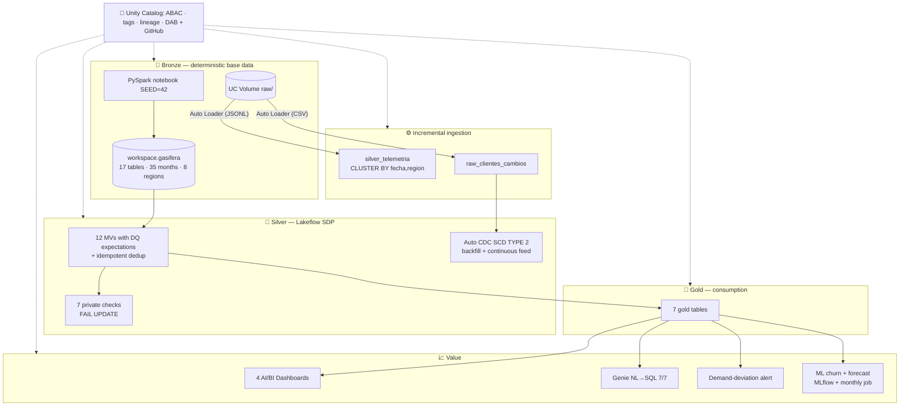

# Gasífera del Valle S.A. — End-to-end data platform on Databricks

[🇪🇸 Español (README principal)](README.md) · **🇬🇧 English** · [🇧🇷 Português](README.pt.md)

> **A complete portfolio project**: reproducible synthetic data → medallion Lakehouse → professional incremental ingestion → honest ML → BI and conversational analytics → governance and CI/CD. All on Unity Catalog, all versioned in Git, all reproducible in any Databricks account.

> **Note on AGEPAR and the data.** This is a study and practice project built around a fictional company (Gasífera del Valle S.A.) and 100% synthetic data. The regulatory indicators (SAIDI, SAIFI, leaks per 100 km, gas quality, CAPEX execution, complaints per 1,000 customers) follow the public business rules of the regulator **AGEPAR**. No data or document comes from real companies. It was built on Databricks Free Edition so anyone can replicate it step by step. License: [MIT](LICENSE).

## What is this?

A **complete data platform for a regulated natural gas distributor** (fictional), built entirely on Databricks to demonstrate mastery of the three data areas:

| Area | What it demonstrates | Measurable evidence |
| --- | --- | --- |
| 🏗️ **Data Engineering** | Medallion lakehouse (bronze→silver→gold) with Lakeflow Spark Declarative Pipelines, Auto Loader, Auto CDC SCD Type 2, liquid clustering, automated DQ and a Declarative Automation Bundle in Git | 17 deterministic synthetic tables, 12 MVs with expectations, 7 private DQ checks, 7 gold tables, SCD2 with 18,075 versions and 0 inconsistencies |
| 📊 **Data Analysis** | Regulatory KPIs, executive dashboards and natural-language analytics | 4 published AI/BI dashboards, Genie NL→SQL agent with a **7/7 correct benchmark**, scheduled demand-deviation alert |
| 🧪 **Data Science** | Supervised ML and time series with honest methodology and MLOps | Churn (LR/RF) with an **honest no-signal report**, forecast with temporal validation (2.86 % MAPE), MLflow + monthly job with retries |
| 🔐 **Governance** (cross-cutting) | Unity Catalog, ABAC, lineage, governed tags | Schema-level PII masking policy, verified gold←silver←bronze lineage |

## The business story

**Gasífera del Valle S.A.** distributes natural gas across 8 regions and must report regulatory KPIs to **AGEPAR** (SAIDI, SAIFI, leaks per 100 km, gas quality, investment execution, satisfaction). Leadership needs to: meet regulatory reports, control CAPEX/OPEX, anticipate demand and detect churn risk.

The project builds the platform that answers those four questions — and then **instruments it** (dashboards, alerts, a conversational agent and automated monthly retraining).

## Architecture



## 1. Data engineering

* **17 tables** (5 dimensions + 11 facts) with realistic seasonality, generated with a fixed seed → identical data in any account (1M+ rows).
* **Auto Loader** on a Unity Catalog volume (JSONL & CSV): each file processed exactly once.
* **Auto CDC SCD Type 2** with the full pattern: initial backfill as events (`INSERT INTO ONCE`) + continuous feed + `IGNORE NULL UPDATES` + delete handling + business `SEQUENCE BY`. 18,075 client versions, exactly one current version per client.
* **Liquid clustering** (`CLUSTER BY (fecha, region)`) with `OPTIMIZE` metrics.
* **12 silver materialized views** with DQ expectations and idempotent dedup; **7 private DQ checks** (FK anti-joins + business rule) with `REFRESH POLICY INCREMENTAL` and `FAIL UPDATE`.
* **7 gold materialized views** with explicit regulatory logic (e.g. **unscheduled** outages only for SAIDI).
* **IaC**: the pipeline lives as a **Declarative Automation Bundle** in this repo (`gasifera_pipeline_calidad_y_gold/`), deployed by **GitHub Actions CI/CD** (`.github/workflows/databricks-deploy.yml`).

## 2. Data analysis

* **4 published AI/BI dashboards**: AGEPAR KPIs, Finance (CAPEX 102.3 %), Demand & Forecast, ML.
* **Genie agent** (natural language → SQL) over 11 tables with curated context: **7/7 benchmark questions correct**, each cross-checked against direct SQL.
* **Scheduled SQL alert**: monthly demand deviation >10 % vs the same month last year (runs after the forecast refresh).

## 3. Data science

* **Churn**: LR & Random Forest, stratified split, class weights, **leakage-free features** (post-churn volume/billing excluded). Honest documented result: the synthetic data contains **no churn signal** (AUC-PR ≈ baseline) — the framework is ready for real data.
* **Demand forecasting**: seasonal naive vs regression (lag-12 + Fourier + trend), **strict temporal validation** (30 months train, 5 months future test). The naive wins: MAPE **2.86 %**, MASE 1.20 — a decision made on evidence, not fashion.
* **MLOps**: MLflow experiments, SparkML model logged to a UC volume, **monthly job** regenerating the 6-month projection (with `max_retries=3`) one day before the deviation alert.

## 📂 Repository structure

```text
├── README.md                          ← Spanish portfolio README
├── README.en.md                       ← you are here
├── docs/
│   ├── 01-ingenieria-inversa.md       ← full technical reverse engineering (Spanish)
│   ├── 02-guia-replicacion/           ← guided prompts to replicate everything (Spanish)
│   └── 03-preguntas-entrevista.md     ← interview Q&A backed by real numbers (Spanish)
├── .github/workflows/                 ← CI/CD: validate + deploy the bundle
└── gasifera_pipeline_calidad_y_gold/  ← the Declarative Automation Bundle (pipeline IaC)
    ├── resources/*.pipeline.yml
    └── src/transformations/           ← SQL: silver (expectations+DQ) and gold
```

## 🎯 Highlights

| Metric | Value |
| --- | --- |
| Data coverage | 35 months × 8 regions × 18,000 clients (deterministic) |
| Client SCD2 versions | 18,075 — 100 % consistent (exactly one current version each) |
| Automated quality checks | 7 private + expectations on 12 MVs |
| Genie NL→SQL | 7/7 business questions correct |
| Forecast | MAPE 2.86 % · MASE 1.20 (honest temporal validation) |
| AGEPAR KPI compliance | 54.3 % overall · CAPEX 102.3 % |
| Governance | ABAC (tag-based PII masking) + end-to-end lineage |

---

*Built with: Databricks Free Edition · Unity Catalog · Lakeflow Spark Declarative Pipelines · Auto Loader · Auto CDC · AI/BI Dashboards · Genie · MLflow · Declarative Automation Bundles · GitHub Actions.*
