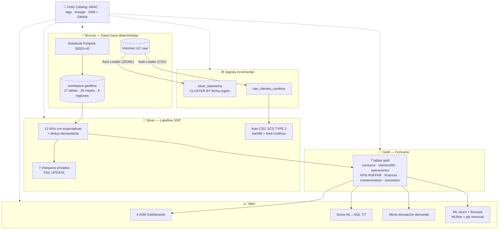
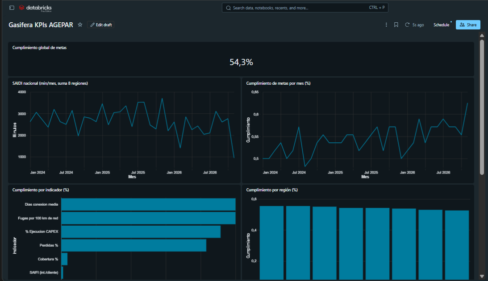
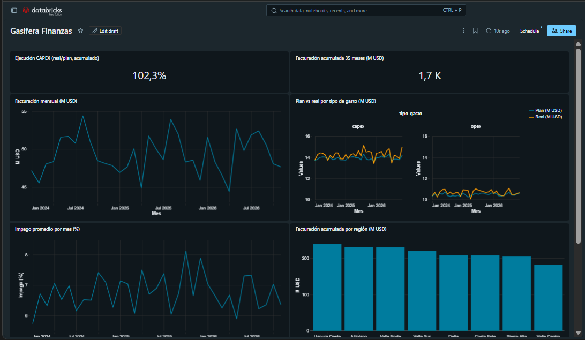
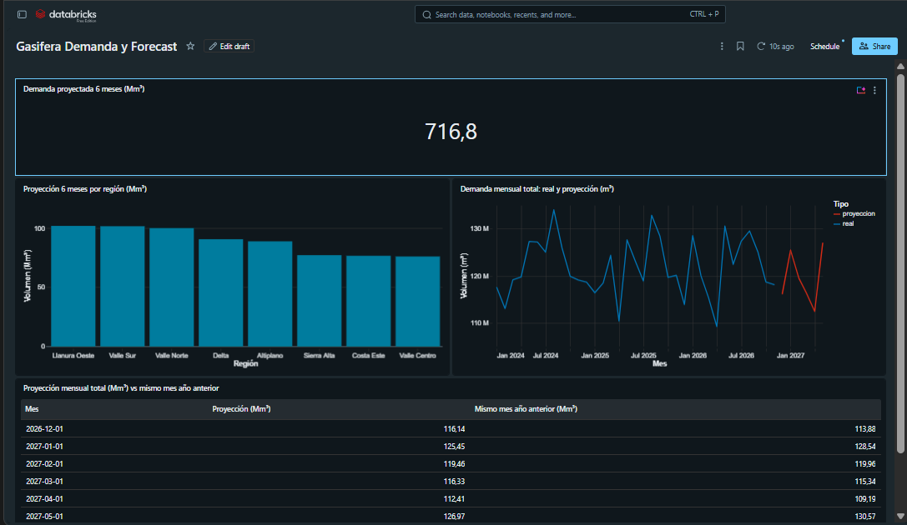
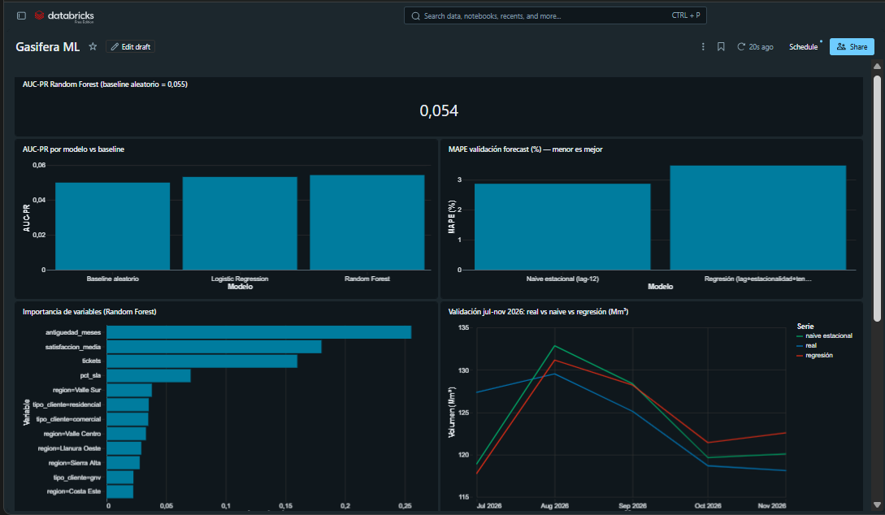

# Gasífera del Valle S.A. — Plataforma de datos end-to-end en Databricks

**🇪🇸 Español** · [🇬🇧 English](README.en.md) · [🇧🇷 Português](README.pt.md)

> **Proyecto de portfolio de ciclo completo**: datos sintéticos reproducibles → Lakehouse medallón → ingesta incremental profesional → ML con validación honesta → BI y analítica conversacional → gobernanza y CI/CD. Todo en Unity Catalog, todo versionado en Git, todo reproducible en cualquier cuenta de Databricks.

---

> **Nota sobre AGEPAR y los datos.** Este proyecto es un ejercicio de estudio y práctica con una empresa ficticia (Gasífera del Valle S.A.) y datos 100 % sintéticos. Los indicadores regulatorios (SAIDI, SAIFI, fugas por 100 km, calidad del gas, ejecución de CAPEX, reclamos por cada 1.000 clientes) siguen las reglas de negocio públicas del regulador **AGEPAR**. Ningún dato ni documento proviene de empresas reales. Se construyó en Databricks Free Edition para que cualquiera pueda replicarlo paso a paso. Licencia: [MIT](LICENSE).

## ¿Qué es esto?

Una **plataforma de datos completa para una distribuidora de gas natural regulada** (empresa y datos ficticios), construida íntegramente en Databricks como demostración de dominio de las tres áreas de datos:

| Área | Qué demuestra | Evidencia medible |
| --- | --- | --- |
| 🏗️ **Ingeniería de datos** | Lakehouse medallón (bronze→silver→gold) con Lakeflow Spark Declarative Pipelines, Auto Loader, Auto CDC SCD Type 2, liquid clustering, DQ automatizada y Declarative Automation Bundle en Git | 17 tablas sintéticas deterministas, 12 MVs con expectativas, 7 chequeos DQ privados, 7 tablas gold, SCD2 con 18.075 versiones y 0 inconsistencias |
| 📊 **Análisis de datos** | KPIs regulatorios, dashboards ejecutivos y analítica en lenguaje natural | 4 dashboards AI/BI publicados, agente Genie NL→SQL con **benchmark 7/7 correcto**, alerta programada de desviación de demanda |
| 🧪 **Ciencia de datos** | ML supervisado y series de tiempo con metodología honesta y MLOps | Churn (LR/RF) con **reporte honesto de ausencia de señal**, forecast con validación temporal (MAPE 2,86 %), MLflow + job mensual con retries |
| 🔐 **Gobernanza** (transversal) | Unity Catalog, ABAC, lineage, tags gobernados | Política de máscara PII a nivel schema, lineage gold←silver←bronze verificado |

---

## La historia de negocio

**Gasífera del Valle S.A.** distribuye gas natural a 8 regiones y debe reportar KPIs regulatorios a la **AGEPAR** (SAIDI, SAIFI, fugas por 100 km, calidad del gas, ejecución de inversión y satisfacción). La dirección necesita: cumplir reportes, controlar finanzas CAPEX/OPEX, anticipar la demanda y detectar clientes en riesgo de baja.

El proyecto construye la plataforma que responde esas cuatro preguntas — y encima la **instrumenta** (dashboards, alertas, agente conversacional y reentrenamiento automático mensual).

---

## Arquitectura



---

## 1. Ingeniería de datos — lo que hay dentro

**Modelado y generación**
* 17 tablas (5 dimensiones + 11 hechos) con estacionalidad realista, generadas con semilla fija → **misma data en cualquier cuenta** (1M+ filas en total).

**Ingesta de nivel Professional**
* **Auto Loader** sobre volumen de Unity Catalog (JSONL y CSV): cada archivo se procesa exactamente una vez.
* **Auto CDC SCD Type 2** con el patrón completo: backfill inicial como eventos (`INSERT INTO ONCE`) + feed continuo + `IGNORE NULL UPDATES` + manejo de deletes + `SEQUENCE BY` de negocio. 18.075 versiones de clientes, una única versión vigente por cliente, historial completo `activo→baja` con `__START_AT`/`__END_AT`.
* **Liquid clustering** (`CLUSTER BY (fecha, region)`) y `OPTIMIZE` ejecutado con métricas.

**Pipeline declarativo (Lakeflow SDP, código 100% SQL en este repo)**
* 12 silver materialized views con **expectativas DQ** (drop/warn) y deduplicación idempotente.
* 7 **chequeos DQ privados** (FKs anti-join y regla de negocio) con `REFRESH POLICY INCREMENTAL` y `FAIL UPDATE` — el pipeline falla si los datos se corrompen.
* 7 gold materialized views con lógica regulatoria explícita (ej.: interrupciones **no programadas** para SAIDI).

**Entrega continua**
* El pipeline vive como **Declarative Automation Bundle** en este repo (`gasifera_pipeline_calidad_y_gold/`), con definición YAML y target `dev` — infraestructura como código.

## 2. Análisis de datos — lo que hay dentro

* **4 dashboards AI/BI publicados**: KPIs AGEPAR (cumplimiento regulatorio), Finanzas (CAPEX 102,3 %, facturación, impago), Demanda y Forecast, y ML.
* **Agente Genie** (preguntas en lenguaje natural → SQL) sobre 11 tablas, con contexto curado, glosario y convenciones: **benchmark de 7 preguntas de negocio, 7/7 correctas** (incluye series temporales, rankings, tasas y comparativos anuales).
* **Alerta SQL programada**: desviación >10 % de la demanda mensual vs el mismo mes del año anterior (corre después de la regeneración del forecast).
* KPIs calculados con criterio regulatorio documentado (SAIDI/SAIFI sin interrupciones programadas, reclamos/1.000 clientes, PCI ponderado...).

## 3. Ciencia de datos — lo que hay dentro

* **Churn**: LR y Random Forest con split estratificado, ponderación de clases y **features sin filtración** (se excluye todo lo que ocurre *por* la baja). Resultado honesto y documentado: los datos sintéticos no contienen señal de churn (AUC-PR ≈ baseline) — se reporta tal cual, con el framework listo para datos reales.
* **Forecasting de demanda**: comparación naive estacional vs regresión con lags + Fourier + tendencia, **validación temporal estricta** (train 30 meses, test 5 meses futuros). Gana el naive: MAPE **2,86 %**, MASE 1,20. La decisión se toma con evidencia, no con moda.
* **MLOps**: experimentos en MLflow, modelo SparkML versionado en volumen UC, y **job mensual** que regenera la proyección a 6 meses (con `max_retries=3`) un día antes de la alerta de desviación.

---

## 📂 Estructura del repositorio

```text
├── README.md                          ← estás aquí (español)
├── README.en.md                       ← versión en inglés
├── docs/
│   ├── 01-ingenieria-inversa.md       ← reconstrucción técnica completa (auditable)
│   ├── 02-guia-replicacion/           ← prompts guiados para replicar TODO en otra cuenta
│   └── 03-preguntas-entrevista.md     ← 15 preguntas técnicas con respuestas basadas en números reales
├── .github/workflows/                 ← CI/CD: valida y despliega el bundle con GitHub Actions
├── dashboards/                        ← los 4 AI/BI dashboards (.lvdash.json) importables
├── gasifera-executive/                ← código de la app (Databricks Apps, panel ejecutivo)
└── gasifera_pipeline_calidad_y_gold/  ← el Declarative Automation Bundle (IaC del pipeline)
    ├── resources/*.pipeline.yml       ← definición del pipeline
    └── src/transformations/           ← SQL: silver (expectativas+DQ) y gold
```

Los dashboards están versionados en [`dashboards/`](dashboards/) (archivos `.lvdash.json` importables desde **Dashboards → Create → Import dashboard JSON**) y se documentan íntegramente en [`docs/01-ingenieria-inversa.md`](docs/01-ingenieria-inversa.md).

### 📸 Dashboards en acción

| KPIs AGEPAR | Finanzas |
| --- | --- |
|  |  |

| Demanda y Forecast | ML |
| --- | --- |
|  |  |

## 🚀 Replicar el proyecto

Todo el proyecto se puede reconstruir en **cualquier cuenta de Databricks** (incluida Free Edition) siguiendo la guía de prompts de [`docs/02-guia-replicacion/`](docs/02-guia-replicacion/): un prompt maestro + 6 fases guiadas con criterios de aceptación verificables para cada una.

## 🎯 Resultados destacados

| Métrica | Valor |
| --- | --- |
| Cobertura de datos | 35 meses × 8 regiones × 18.000 clientes (determinista) |
| Versiones SCD2 de clientes | 18.075 — 100 % íntegras (1 versión vigente por cliente) |
| Chequeos de calidad automatizados | 7 privados + expectativas en 12 MVs |
| Genie NL→SQL | 7/7 preguntas de negocio correctas |
| Forecast | MAPE 2,86 % · MASE 1,20 (validación temporal honesta) |
| Cumplimiento KPIs AGEPAR | 54,3 % global · CAPEX 102,3 % |
| Gobernanza | ABAC (máscara PII por tag) + lineage end-to-end |
| CI/CD | GitHub Actions: `bundle validate` + `bundle deploy` en cada push |
| App productiva | [Gasifera Executive](https://gasifera-executive-2829882457547295.aws.databricksapps.com) — panel ejecutivo en vivo sobre el lakehouse |

---

*Construido con: Databricks Free Edition · Unity Catalog · Lakeflow Spark Declarative Pipelines · Auto Loader · Auto CDC · AI/BI Dashboards · Genie · MLflow · Databricks Apps · Declarative Automation Bundles · GitHub Actions.*
