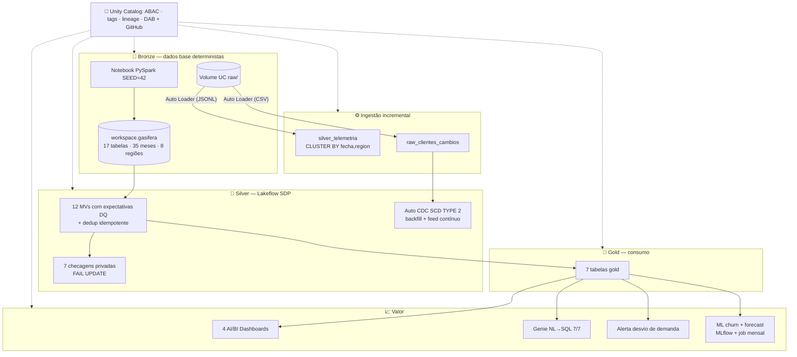

# Gasífera del Valle S.A. — Plataforma de dados de ponta a ponta em Databricks

[🇪🇸 Español (README principal)](README.md) · [🇬🇧 English](README.en.md) · **🇧🇷 Português**

> **Projeto de portfólio de ciclo completo**: dados sintéticos reproduzíveis → Lakehouse medalhão → ingestão incremental profissional → ML com validação honesta → BI e analítica conversacional → governança e CI/CD. Tudo em Unity Catalog, tudo versionado em Git, tudo reproduzível em qualquer conta Databricks.

## O que é isto?

Uma **plataforma de dados completa para uma distribuidora de gás natural regulada** (fictícia), construída integralmente em Databricks para demonstrar domínio das três áreas de dados:

| Área | O que demonstra | Evidência mensurável |
| --- | --- | --- |
| 🏗️ **Engenharia de Dados** | Lakehouse medalhão (bronze→silver→gold) com Lakeflow Spark Declarative Pipelines, Auto Loader, Auto CDC SCD Type 2, liquid clustering, DQ automatizada e Declarative Automation Bundle em Git | 17 tabelas sintéticas deterministas, 12 MVs com expectativas, 7 checagens DQ privadas, 7 tabelas gold, SCD2 com 18.075 versões e 0 inconsistências |
| 📊 **Análise de Dados** | KPIs regulatórios, dashboards executivos e analítica em linguagem natural | 4 dashboards AI/BI publicados, agente Genie NL→SQL com **benchmark 7/7 correto**, alerta programado de desvio de demanda |
| 🧪 **Ciência de Dados** | ML supervisionado e séries temporais com metodologia honesta e MLOps | Churn (LR/RF) com **relato honesto de ausência de sinal**, forecast com validação temporal (MAPE 2,86 %), MLflow + job mensal com retries |
| 🔐 **Governança** (transversal) | Unity Catalog, ABAC, lineage, tags governadas | Política de máscara PII em nível de schema, lineage gold←silver←bronze verificado |

## A história de negócio

**Gasífera del Valle S.A.** distribui gás natural em 8 regiões e deve reportar KPIs regulatórios à **AGEPAR** (SAIDI, SAIFI, vazamentos por 100 km, qualidade do gás, execução de investimento e satisfação). A direção precisa: cumprir relatórios regulatórios, controlar finanças CAPEX/OPEX, antecipar a demanda e detectar clientes em risco de churn.

O projeto constrói a plataforma que responde essas quatro perguntas — e ainda a **instrumenta** (dashboards, alertas, agente conversacional e retraining automático mensal).

## Arquitetura



## 1. Engenharia de dados

* **17 tabelas** (5 dimensões + 11 fatos) com sazonalidade realista, geradas com semente fixa → dados idênticos em qualquer conta (1M+ linhas).
* **Auto Loader** sobre volume do Unity Catalog (JSONL e CSV): cada arquivo processado exatamente uma vez.
* **Auto CDC SCD Type 2** com o padrão completo: backfill inicial como eventos (`INSERT INTO ONCE`) + feed contínuo + `IGNORE NULL UPDATES` + tratamento de deletes + `SEQUENCE BY` de negócio. 18.075 versões de clientes, exatamente uma versão vigente por cliente.
* **Liquid clustering** (`CLUSTER BY (fecha, region)`) com métricas de `OPTIMIZE`.
* **12 silver materialized views** com expectativas DQ e deduplicação idempotente; **7 checagens DQ privadas** (anti-joins de FK + regra de negócio) com `REFRESH POLICY INCREMENTAL` e `FAIL UPDATE`.
* **7 gold materialized views** com lógica regulatória explícita (ex.: interrupções **não programadas** apenas para SAIDI).
* **IaC**: o pipeline vive como **Declarative Automation Bundle** neste repositório (`gasifera_pipeline_calidad_y_gold/`), implantado por **GitHub Actions CI/CD** (`.github/workflows/databricks-deploy.yml`).

## 2. Análise de dados

* **4 dashboards AI/BI publicados**: KPIs AGEPAR, Finanças (CAPEX 102,3 %), Demanda e Forecast, ML.
* **Agente Genie** (linguagem natural → SQL) sobre 11 tabelas com contexto curado: **benchmark de 7 perguntas de negócio, 7/7 corretas**, cada uma verificada contra SQL direto.
* **Alerta SQL programado**: desvio mensal da demanda >10 % vs o mesmo mês do ano anterior (roda após a regeneração do forecast).

## 3. Ciência de dados

* **Churn**: LR e Random Forest, split estratificado, pesos de classe, **features sem vazamento** (volume/faturamento pós-baixa excluídos). Resultado honesto e documentado: os dados sintéticos **não contêm sinal de churn** (AUC-PR ≈ baseline) — o framework está pronto para dados reais.
* **Forecast de demanda**: naive sazonal vs regressão (lag-12 + Fourier + tendência), **validação temporal estrita** (30 meses de treino, 5 meses de teste no futuro). O naive vence: MAPE **2,86 %**, MASE 1,20 — decisão por evidência, não por moda.
* **MLOps**: experimentos em MLflow, modelo SparkML registrado em volume UC, **job mensal** que regenera a projeção de 6 meses (com `max_retries=3`) um dia antes do alerta de desvio.

## 📂 Estrutura do repositório

```text
├── README.md                          ← README de portfólio (espanhol)
├── README.en.md                       ← versão em inglês
├── README.pt.md                       ← você está aqui
├── docs/
│   ├── 01-ingenieria-inversa.md       ← engenharia reversa técnica completa (espanhol)
│   ├── 02-guia-replicacion/           ← prompts guiados para replicar tudo (espanhol)
│   └── 03-preguntas-entrevista.md     ← perguntas de entrevista com números reais (espanhol)
├── .github/workflows/                 ← CI/CD: valida e implanta o bundle
├── gasifera-executive/                ← código do app (Databricks Apps, painel executivo)
└── gasifera_pipeline_calidad_y_gold/  ← o Declarative Automation Bundle (IaC do pipeline)
    ├── resources/*.pipeline.yml
    └── src/transformations/           ← SQL: silver (expectativas+DQ) e gold
```

## 🚀 Replicar o projeto

Todo o projeto pode ser reconstruído em **qualquer conta Databricks** (incluída a Free Edition) seguindo o guia de prompts em [`docs/02-guia-replicacion/`](docs/02-guia-replicacion/): um prompt mestre + 6 fases guiadas com critérios de aceite verificáveis.

## 🎯 Destaques

| Métrica | Valor |
| --- | --- |
| Cobertura de dados | 35 meses × 8 regiões × 18.000 clientes (determinista) |
| Versões SCD2 de clientes | 18.075 — 100 % consistentes (1 versão vigente por cliente) |
| Checagens de qualidade automatizadas | 7 privadas + expectativas em 12 MVs |
| Genie NL→SQL | 7/7 perguntas de negócio corretas |
| Forecast | MAPE 2,86 % · MASE 1,20 (validação temporal honesta) |
| Cumprimento KPIs AGEPAR | 54,3 % global · CAPEX 102,3 % |
| Governança | ABAC (máscara PII por tag) + lineage de ponta a ponta |
| CI/CD | GitHub Actions: `bundle validate` + `bundle deploy` a cada push |
| App em produção | [Gasifera Executive](https://gasifera-executive-2829882457547295.aws.databricksapps.com) — painel executivo em tempo real sobre o lakehouse |

---

*Construído com: Databricks Free Edition · Unity Catalog · Lakeflow Spark Declarative Pipelines · Auto Loader · Auto CDC · AI/BI Dashboards · Genie · MLflow · Databricks Apps · Declarative Automation Bundles · GitHub Actions.*
