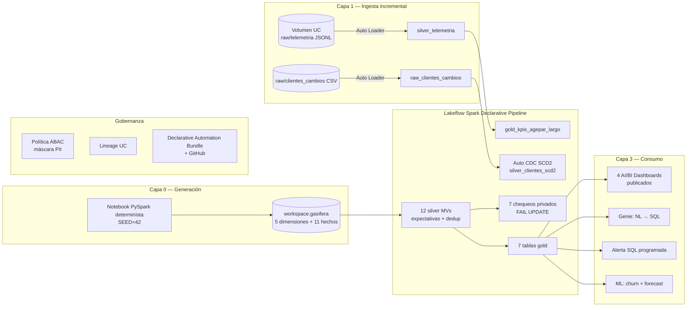

# Ingeniería inversa del proyecto Gasífera del Valle S.A.

Documento técnico que reconstruye, pieza por pieza, cómo está construido el proyecto completo en Databricks. Es la referencia canónica para entender, auditar y replicar todo lo que existe.

---

## 1. Contexto de negocio simulado

**Gasífera del Valle S.A.** es una empresa ficticia de distribución de gas natural regulada por la **AGEPAR** (regulador real; se usan sus reglas de negocio públicas como referencia, mientras que la empresa y los datos son ficticios). El caso cubre 8 regiones geográficas, 40 estaciones de regulación y medición (AGEPAR exige reportar SAIDI, SAIFI, fugas por 100 km, PCI del gas, % de ejecución CAPEX y reclamos por cada 1.000 clientes).

Los datos son **100% sintéticos y deterministas** (semilla fija), generados con PySpark: cualquiera que replique el proyecto obtiene exactamente los mismos números.

---

## 2. Arquitectura general



**Catálogos y schemas de Unity Catalog:**

| Objeto | Rol |
| --- | --- |
| `workspace.gasifera` | Datos sintéticos base (bronze hecho a mano) + funciones + tags |
| `workspace.gasifera_silver` | Salidas del pipeline: MVs de silver, streaming tables, chequeos DQ privados |
| `workspace.gasifera_gold` | 7 tablas gold materializadas, listas para BI/ML |
| `workspace.gasifera.raw` (volumen) | Archivos de ingesta incremental (JSONL y CSV) |

---

## 3. Capa 0 — Datos sintéticos (notebook `Proyecto Gasifera Datos Sinteticos`)

* **Determinismo total:** `SEED = 42` y helpers `elegir()` / `aleatorios()` sobre `random.Random` — reproducción exacta entre ejecuciones y cuentas.
* **Período:** enero 2024 – noviembre 2026 (35 meses completos).
* **17 tablas:**
  * Dimensiones: `dim_regiones` (8), `dim_estaciones` (40), `dim_red_segmentos` (2.500), `dim_clientes` (18.000), `dim_empleados` (1.200).
  * Hechos: `fact_consumo_mensual` (630.000), `fact_presiones` (200.000), `fact_calidad_gas` (1.400), `fact_interrupciones` (4.200), `fact_incidentes_seguridad` (2.600), `fact_mantenimiento` (30.000), `fact_atencion_clientes` (60.000), `fact_conexiones` (15.000), `fact_finanzas` (3.360), `fact_compras_suministro` (210), `fact_ambiental` (280), `fact_metricas_agepar` (280).
* **Realismo:** estacionalidad en consumo (invierno > verano), IDs con base 0 (`CLI000000+`, `EST000+`, `SEG0000+`, `EMP00000+`), moneda USD, regiones con distinta carga.
* **KPIs AGEPAR calculados desde los hechos** (no inventados): SAIDI/SAIFI solo con interrupciones NO programadas, fugas/100 km sobre la longitud de red, reclamos/1.000 clientes, PCI promedio ponderado, % ejecución CAPEX.

---

## 4. Capa 1 — Ingesta incremental (nivel Professional)

### 4.1 Auto Loader (archivos → Delta)

`transformations/silver/silver_telemetria.sql`:

* Fuente: volumen `/Volumes/workspace/gasifera/raw/telemetria` con **14 archivos JSONL** (1 medición por línea, 40 estaciones × 14 días).
* Patrón: `STREAMING TABLE ... FROM STREAM(read_files('<ruta>', format => 'json'))` — cada archivo se procesa **exactamente una vez**.
* **Expectativas DQ en la propia tabla:** `estacion_presente` (DROP), `caudal_positivo` (DROP), `presion_fisica` 0–6 barg (WARN).
* **Liquid clustering:** `CLUSTER BY (fecha, region)` — verificado en propiedades de la tabla (`clusteringColumns`).

### 4.2 Auto CDC con SCD Tipo 2

`transformations/silver/silver_clientes_cdc.sql` — la pieza más sofisticada del pipeline:

```text
raw_clientes_cambios (Auto Loader CSV, schemaHints fecha_cambio DATE)
  → clientes_cambios_limpios   (PRIVATE ST: NULLIF de vacíos, filtro de operaciones válidas)
  → clientes_feed_unificado    (PRIVATE ST con DOS append flows):
       • clientes_backfill_inicial (INSERT INTO ONCE, batch desde dim_clientes,
         fecha_cambio = fecha_alta → el estado histórico entra como evento)
       • clientes_cambios_flow (STREAM continuo del feed de cambios)
  → AUTO CDC INTO silver_clientes_scd2
       KEYS (cliente_id)
       IGNORE NULL UPDATES          -- los UPDATE solo traen estado, no pisan nombre/tipo
       APPLY AS DELETE WHEN operacion = 'DELETE'
       SEQUENCE BY fecha_cambio     -- ordena el historial por fecha de negocio
       STORED AS SCD TYPE 2         -- genera __START_AT / __END_AT
```

**Resultado verificado:** 18.075 versiones, 18.025 clientes con exactamente una versión vigente, 50 historias cerradas (40 bajas + 10 reactivaciones). Ejemplo real: `CLI017627` → `activo` desde 1996-07-28, cerrado el 2026-11-17, `baja` vigente.

---

## 5. Capa 2 — Pipeline declarativo (Lakeflow SDP)

* Pipeline id `8ba2d8f7-7147-4c80-bf5b-9366ea843a3e`, serverless, catálogo `workspace`, schema `gasifera_silver`, glob `transformations/**`.
* **20+ archivos SQL** en `transformations/silver` y `transformations/gold` — el código ES la documentación.

### Silver (12 MVs + streaming tables)
* Cada MV valida con expectativas (`EXPECT ... ON VIOLATION DROP ROW` / warn) basadas en las reglas DQ del negocio (presiones positivas, tickets únicos, satisfacción 1–5, montos no negativos, dominios de estado...).
* Deduplicación idempotente con `QUALIFY row_number() OVER (PARTITION BY clave ORDER BY ...)`.

### Chequeos DQ privados (7)
* `dq_fk_checks.sql` define **MVs `PRIVATE`** con `REFRESH POLICY INCREMENTAL`: anti-joins de claves foráneas (DQ06–DQ11) y DQ22 (baja sin consumo), todos con `FAIL UPDATE`.
* Patrón avanzado: la expectativa se evalúa sobre la fila de resultado del chequeo (el agregado), no sobre las filas fuente — un MV vacío significa datos válidos.

### Gold (7 tablas)
| Tabla | Granularidad | Contenido clave |
| --- | --- | --- |
| `gold_consumo_mensual` | periodo × region × tipo_cliente | clientes, volumen, energía, facturación, impago |
| `gold_clientes_360` | cliente | consumo + atención + `riesgo_baja` (estado='baja' O ≤3 meses de consumo) |
| `gold_operaciones_mensual` | mes × region | interrupciones NO programadas (criterio regulatorio), incidentes, presiones, calidad |
| `gold_kpis_agepar_largo` | mes × indicador | 7 KPIs formato largo con valor, meta, sentido y cumplimiento |
| `gold_finanzas_mensual` | mes × tipo_gasto | CAPEX/OPEX plan vs real y desvío % |
| `gold_mantenimiento_mensual` | mes × tipo_orden | órdenes, % en plazo, horas, costo |
| `gold_suministro_mensual` | mes | compras, contratado vs entregado, penalidades |

---

## 6. Capa 3 — Consumo y análisis

### 4 dashboards AI/BI (todos publicados)
1. **Gasifera KPIs AGEPAR** — cumplimiento global (54,3 %), por mes/indicador/región, SAIDI nacional.
2. **Gasifera Finanzas** — ejecución CAPEX 102,3 %, plan vs real, facturación por región, impago.
3. **Gasifera Demanda y Forecast** — demanda real vs proyección ML a 6 meses.
4. **Gasifera ML** — métricas de modelos, importancias, riesgo de baja, validación del forecast.

### Genie (NL → SQL)
* Espacio sobre 11 tablas con instrucciones curadas (contexto de negocio, glosario AGEPAR, convenciones de esquema, formato de respuesta con tabla + gráfico).
* **Benchmark de 7 preguntas reales: 7/7 correctas** tras iterar el prompt (incluida una corrección de escala de porcentajes).

### Alerta programada
* `Gasifera Desviacion de Demanda Mensual`: |desviación %| del último mes vs mismo mes del año anterior > 10, cron mensual día 3 (después de regenerar el forecast el día 2).

---

## 7. Capa 4 — Ciencia de datos (notebook `Gasifera ML Churn y Forecasting`)

### Churn (clasificación)
* Modelos: Regresión Logística y Random Forest (`weightCol`, split estratificado, semilla 42).
* Features sin filtración: tipo_cliente, región, antigüedad, tickets, % SLA, satisfacción media — **excluidos volumen/facturación post-baja** (leakage).
* **Resultado honesto: SIN señal** — AUC-ROC 0,486/0,502, AUC-PR 0,053/0,054 vs baseline 0,055. Las bajas sintéticas no tienen comportamiento previo. Se documenta como resultado válido de una metodología correcta (un proyecto real demostraría si hay señal).

### Forecasting (serie temporal)
* Validación temporal honesta: train ene-24–jun-26, test jul–nov-26 (nunca shuffle).
* **Naive estacional gana:** MAPE 2,86 % / MAE 3,60 Mm³ vs regresión (lag-12 + Fourier + tendencia) 3,47 % / 4,30; MASE 1,20.
* Proyección dic-26 → may-27 ≈ 116–127 Mm³/mes, materializada en `workspace.gasifera.ml_forecast_demanda` (TOTAL + 8 regiones).

### MLOps
* MLflow: run trackeado, modelo SparkML logueado con artefactos en volumen UC (`/Volumes/workspace/gasifera/ml_models`).
* **Job mensual** `Gasifera Regenerar Forecast` (día 2, 05:00, America/Bogota) con `max_retries=3`, intervalo de reintento 5 min y reintento por timeout — regenera la proyección un día antes de la alerta.

---

## 8. Gobernanza

* **ABAC:** política `mascara_documentos_dni` a nivel schema `workspace.gasifera` — toda columna con el governed tag `class.es_dni` (asignado a `dim_clientes.documento`) se enmascara con la UDF `mascara_pii` para todos menos el propietario.
* **Lineage:** trazabilidad verificada end-to-end (`gold_consumo_mensual ← silver_consumo_mensual ← fact_consumo_mensual`).
* **Declarative Automation Bundle:** el pipeline vive en este repo Git (carpeta `gasifera_pipeline_calidad_y_gold/`), con definición `resources/*.pipeline.yml` y target `dev` — la fuente de verdad es el código versionado, no el workspace.

---

## 9. Decisiones de diseño y lecciones (gotchas reales)

1. **Determinismo antes que volumen:** datos pequeños pero 100 % reproducibles valen más para un portfolio que millones de filas aleatorias.
2. **SCD2 con backfill:** un feed CDC solo trae cambios; el estado inicial debe entrar como eventos (append flow `ONCE`) con `fecha_cambio = fecha_alta`, o cada cliente queda con una sola versión.
3. **Cambiar el fuente de un flujo CDC rompe su checkpoint** (`DIFFERENT_DELTA_TABLE_READ_BY_STREAMING_SOURCE`) → se resetea el checkpoint del flujo, no la tabla.
4. **Las gold MVs no admiten `OPTIMIZE`** — Lakeflow las mantiene; `OPTIMIZE` sí aplica a streaming tables con liquid clustering.
5. **Expectativa warn = sin cláusula**; `IGNORE NULL UPDATES ON (cols)` no existe en SQL (versión simple).
6. **`MATCH COLUMNS` de ABAC** usa `has_tag('clave')`, no comparadores ni `is_column_tag_key`.
7. **Churn sin señal se reporta como tal** — demostrar honestidad metodológica vale más que una métrica inflada con leakage.
8. **Naive beats ML** en series cortas y estables: validación temporal honesta lo demuestra y se toma la decisión con evidencia.
9. **Todo el código SQL del pipeline es idempotente** (`CREATE OR REFRESH`) — el mismo código reconstruye el estado completo en cualquier cuenta.
